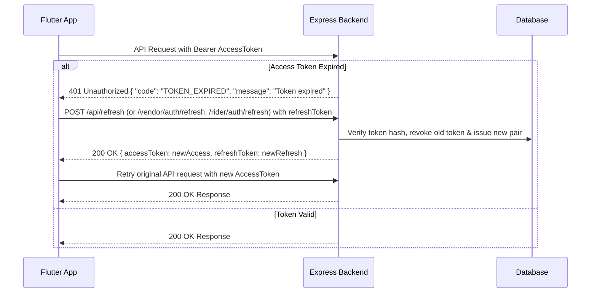

# Grahmitra Complete Backend API Documentation
> **Target Audience:** Flutter & Mobile Application Developers (Customer App, Vendor App, Rider App)  
> **Backend Architecture:** Express.js + MySQL / MariaDB  
> **Auth Scheme:** JWT Bearer Authentication (`accessToken` with 15-minute expiry, `refreshToken` with 7-day expiry and database rotation)  
> **Date:** September 2026

---

## Table of Contents
1. [General Integration Guide for Flutter Developers](#general-integration-guide-for-flutter-developers)
   - [Base URLs & Environment](#base-urls--environment)
   - [Standard Headers](#standard-headers)
   - [Authentication & JWT Lifecycle](#authentication--jwt-lifecycle)
   - [Standard Response Formats](#standard-response-formats)
   - [Image Uploads (Multipart FormData)](#image-uploads-multipart-formdata)
   - [Flutter / Dart Dio Interceptor Pattern](#flutter--dart-dio-interceptor-pattern)
2. [Customer & Public Storefront APIs](#1-customer--public-storefront-apis)
   - [Customer Authentication & Identity](#11-customer-authentication--identity)
   - [Password Recovery](#12-password-recovery)
   - [Categories, Groups & Master Location Data](#13-categories-groups--master-location-data)
   - [Product Catalog & Storefront Browsing](#14-product-catalog--storefront-browsing)
   - [Deals of the Day & Spotlight Banners](#15-deals-of-the-day--spotlight-banners)
   - [Cart, Checkout & Pricing Validation](#16-cart-checkout--pricing-validation)
   - [Order Placement & Tracking](#17-order-placement--tracking)
   - [Customer Saved Addresses](#18-customer-saved-addresses)
   - [Customer Wallet & Referral Program](#19-customer-wallet--referral-program)
   - [Coupons](#110-coupons)
   - [Payment Gateway Integration](#111-payment-gateway-integration)
3. [Vendor Portal / Vendor App APIs](#2-vendor-portal--vendor-app-apis)
   - [Vendor Authentication](#21-vendor-authentication)
   - [Vendor Profile, Store & Delivery Areas](#22-vendor-profile-store--delivery-areas)
   - [Vendor Products & Catalog Management](#23-vendor-products--catalog-management)
   - [Vendor Orders & Fulfilment](#24-vendor-orders--fulfilment)
   - [Vendor Dashboard, Stats & Settlements](#25-vendor-dashboard-stats--settlements)
   - [Vendor Coupons](#26-vendor-coupons)
   - [Vendor Deals of the Day](#27-vendor-deals-of-the-day)
   - [Vendor Rider Management](#28-vendor-rider-management)
   - [Vendor Notifications](#29-vendor-notifications)
4. [Rider App APIs](#3-rider-app-apis)
   - [Rider Authentication](#31-rider-authentication)
   - [Rider Profile & Live GPS Location](#32-rider-profile--live-gps-location)
   - [Rider Shipments & Delivery Fulfilment](#33-rider-shipments--delivery-fulfilment)
   - [Rider Notifications](#34-rider-notifications)

---

## General Integration Guide for Flutter Developers

### Base URLs & Environment
- **Development / Localhost (Android Emulator):** `http://10.0.2.2:4000`
- **Development / Localhost (iOS Simulator):** `http://127.0.0.1:4000`
- **Development / Physical Device:** `http://<your-lan-ip>:4000`
- **Production:** `https://api.yourdomain.com`

### Standard Headers
| Header Name | Value / Format | Required On | Description |
| :--- | :--- | :--- | :--- |
| `Content-Type` | `application/json` | All JSON `POST`, `PUT` | Indicates JSON payload body |
| `Accept` | `application/json` | All Requests | Expects JSON response |
| `Authorization` | `Bearer <accessToken>` | Protected Endpoints | Access token for the authenticated user |

---

### Authentication & JWT Lifecycle
The backend uses short-lived **Access Tokens** (15 minutes) and rotated **Refresh Tokens** (7 days).



1. When any protected endpoint returns `401 Unauthorized` with body `{ "code": "TOKEN_EXPIRED" }`:
   - Send `POST /api/refresh` (for Customer), `POST /vendor/auth/refresh` (for Vendor), or `POST /rider/auth/refresh` (for Rider) with `{ "refreshToken": "..." }`.
   - The backend validates the refresh token, revokes the old token, and returns a new `accessToken` and a new `refreshToken`.
   - Store both new tokens in `flutter_secure_storage` or `SharedPreferences`.
   - Re-issue the failed request with the new access token.
2. If refresh fails (token revoked or expired), log out the user and navigate to the Login screen.

---

### Standard Response Formats

#### Success Response
```json
{
  "success": true,
  "message": "Operation completed successfully",
  "data": { ... }
}
```

#### Client / Validation Error (`400 Bad Request`, `403 Forbidden`, `404 Not Found`)
```json
{
  "success": false,
  "message": "Human readable explanation of the error"
}
```

#### Token Expired (`401 Unauthorized`)
```json
{
  "success": false,
  "message": "Token expired",
  "code": "TOKEN_EXPIRED"
}
```

#### Rate Limit Exceeded (`429 Too Many Requests`)
```json
{
  "success": false,
  "message": "Too many attempts. Please try again after 15 minutes."
}
```

---

### Image Uploads (Multipart FormData)
When endpoints accept image uploads (such as `/vendor/products/upload`, `/vendor/products/:id/images`, etc.):
- Send `POST` with `multipart/form-data`.
- Field name: `file` or `image` (specified in each endpoint below).
- Max allowed size: up to 25 MB (server compresses and transforms images to WebP via Cloudflare R2).

---

### Flutter / Dart Dio Interceptor Pattern
Use this standard Dio Interceptor setup in your Flutter app to handle token attachments and automatic refresh:

```dart
import 'package:dio/dio.dart';

class ApiClient {
  static final Dio dio = Dio(BaseOptions(
    baseUrl: 'https://api.yourdomain.com',
    connectTimeout: const Duration(seconds: 15),
    receiveTimeout: const Duration(seconds: 15),
    headers: {'Content-Type': 'application/json', 'Accept': 'application/json'},
  ));

  static void initialize(String userRole) {
    dio.interceptors.add(
      InterceptorsWrapper(
        onRequest: (options, handler) async {
          final token = await SecureStorageService.getAccessToken();
          if (token != null && token.isNotEmpty) {
            options.headers['Authorization'] = 'Bearer $token';
          }
          return handler.next(options);
        },
        onError: (DioException error, handler) async {
          if (error.response?.statusCode == 401 &&
              error.response?.data?['code'] == 'TOKEN_EXPIRED') {
            final refreshed = await _refreshToken(userRole);
            if (refreshed) {
              final newOptions = error.requestOptions;
              final newToken = await SecureStorageService.getAccessToken();
              newOptions.headers['Authorization'] = 'Bearer $newToken';
              final response = await dio.fetch(newOptions);
              return handler.resolve(response);
            }
          }
          return handler.next(error);
        },
      ),
    );
  }

  static Future<bool> _refreshToken(String role) async {
    final currentRefresh = await SecureStorageService.getRefreshToken();
    if (currentRefresh == null) return false;

    String refreshEndpoint = '/api/refresh';
    if (role == 'vendor') refreshEndpoint = '/vendor/auth/refresh';
    if (role == 'rider') refreshEndpoint = '/rider/auth/refresh';

    try {
      final res = await Dio().post(
        '${dio.options.baseUrl}$refreshEndpoint',
        data: {'refreshToken': currentRefresh},
      );
      if (res.statusCode == 200 && res.data['success'] == true) {
        await SecureStorageService.saveTokens(
          access: res.data['accessToken'],
          refresh: res.data['refreshToken'],
        );
        return true;
      }
    } catch (_) {}
    await SecureStorageService.clearAll();
    return false;
  }
}
```

---

## 1. Customer & Public Storefront APIs

### 1.1 Customer Authentication & Identity

#### Standalone MSG91 Widget Access Token Verification
- **Method & Route:** `POST /api/auth/verify-msg91`
- **Auth Required:** No
- **Request Body:**
```json
{
  "accessToken": "jwt_string_returned_by_msg91_otp_widget"
}
```
- **Response (200 OK):**
```json
{
  "success": true,
  "message": "MSG91 access token verified successfully",
  "data": {
    "mobile": "+919876543210"
  },
  "devMode": false
}
```

---

#### Request Registration (Phone Check)
- **Method & Route:** `POST /api/register-request`
- **Auth Required:** No
- **Request Body:**
```json
{
  "first_name": "Rahul",
  "last_name": "Sharma",
  "phone": "9876543210",
  "email": "rahul@example.com",
  "password": "StrongPassword123"
}
```
- **Response (200 OK):**
```json
{
  "success": true,
  "message": "Phone number available for MSG91 OTP widget registration"
}
```

---

#### Verify Registration & Create Customer Account
- **Method & Route:** `POST /api/register-verify`
- **Auth Required:** No
- **Request Body:**
```json
{
  "first_name": "Rahul",
  "last_name": "Sharma",
  "phone": "9876543210",
  "email": "rahul@example.com",
  "password": "StrongPassword123",
  "accessToken": "msg91_widget_access_token",
  "referral_code": "GMFEB12A"
}
```
- **Response (200 OK):**
```json
{
  "success": true,
  "message": "Account created and verified successfully!",
  "accessToken": "eyJhbGciOiJIUzI1NiIsInR5cCI6IkpXVCJ9...",
  "refreshToken": "eyJhbGciOiJIUzI1NiIsInR5cCI6IkpXVCJ9..."
}
```

---

#### Customer Login (Mobile / Email + Password)
- **Method & Route:** `POST /api/login`
- **Auth Required:** No
- **Rate Limit:** 15 requests per 15 minutes
- **Request Body:**
```json
{
  "phone": "9876543210",
  "password": "StrongPassword123"
}
```
*(Note: You can pass either `phone` or `email`)*
- **Response (200 OK):**
```json
{
  "success": true,
  "accessToken": "eyJhbGciOiJIUzI1NiIsInR5cCI6IkpXVCJ9...",
  "refreshToken": "eyJhbGciOiJIUzI1NiIsInR5cCI6IkpXVCJ9..."
}
```

---

#### Customer Login / Auto-Signup with MSG91 OTP
Instant 1-click login or auto-registration (Blinkit style). If the phone number is new, a customer account is automatically provisioned and referral bonus credited if `referralCode` is given.
- **Method & Route:** `POST /api/login-with-otp`
- **Auth Required:** No
- **Request Body:**
```json
{
  "phone": "9876543210",
  "accessToken": "msg91_widget_verified_token",
  "referralCode": "GMFEB12A"
}
```
- **Response (200 OK):**
```json
{
  "success": true,
  "message": "Logged in successfully!",
  "isNewUser": false,
  "accessToken": "eyJhbGciOiJIUzI1NiIsInR5cCI6IkpXVCJ9...",
  "refreshToken": "eyJhbGciOiJIUzI1NiIsInR5cCI6IkpXVCJ9..."
}
```

---

#### Refresh Customer Access Token
- **Method & Route:** `POST /api/refresh`
- **Auth Required:** No
- **Request Body:**
```json
{
  "refreshToken": "eyJhbGciOiJIUzI1NiIsInR5cCI6IkpXVCJ9..."
}
```
- **Response (200 OK):**
```json
{
  "success": true,
  "accessToken": "new_jwt_access_token_here",
  "refreshToken": "new_rotated_refresh_token_here"
}
```

---

#### Get Current Logged-in Customer Profile
- **Method & Route:** `GET /api/me`
- **Auth Required:** Yes (`Bearer <token>`)
- **Response (200 OK):**
```json
{
  "success": true,
  "user": {
    "id": 42,
    "first_name": "Rahul",
    "last_name": "Sharma",
    "email": "rahul@example.com",
    "phone": "+919876543210",
    "user_role": "customer",
    "created_date": "2026-03-01T10:00:00.000Z",
    "is_active": 1
  }
}
```

---

#### Update Customer FCM Token (Push Notifications)
- **Method & Route:** `POST /api/update-fcm-token`
- **Auth Required:** Yes (`Bearer <token>`)
- **Request Body:**
```json
{
  "fcm_token": "fN819_k0...firebase_device_token_here"
}
```
- **Response (200 OK):**
```json
{
  "success": true,
  "message": "FCM token updated successfully"
}
```

---

#### Customer Logout
- **Method & Route:** `POST /api/logout`
- **Auth Required:** Yes (`Bearer <token>`)
- **Request Body:**
```json
{
  "refreshToken": "current_refresh_token_to_revoke"
}
```
- **Response (200 OK):**
```json
{
  "success": true,
  "message": "Logged out successfully"
}
```

---

### 1.2 Password Recovery

#### 1. Forgot Password Request
- **Method & Route:** `POST /api/forgot-password`
- **Auth Required:** No
- **Request Body:**
```json
{
  "phone": "9876543210"
}
```
- **Response (200 OK):**
```json
{
  "success": true,
  "message": "User found."
}
```

---

#### 2. Verify Forgot Password OTP
- **Method & Route:** `POST /api/verify-forgot-otp`
- **Auth Required:** No
- **Request Body:**
```json
{
  "phone": "9876543210",
  "accessToken": "msg91_widget_access_token"
}
```
- **Response (200 OK):**
```json
{
  "success": true,
  "message": "OTP verified successfully",
  "token": "4e76a91c78...reset_token_hex_string"
}
```

---

#### 3. Reset Password
- **Method & Route:** `POST /api/reset-password`
- **Auth Required:** No
- **Request Body:**
```json
{
  "token": "4e76a91c78...reset_token_hex_string",
  "newPassword": "NewStrongPassword123",
  "confirmPassword": "NewStrongPassword123"
}
```
- **Response (200 OK):**
```json
{
  "success": true,
  "message": "Password reset successfully"
}
```

---

### 1.3 Categories, Groups & Master Location Data

#### Get All Categories
- **Method & Route:** `GET /api/categories`
- **Auth Required:** No
- **Response (200 OK):**
```json
[
  {
    "id": 1,
    "name": "Grocery & Staples",
    "cat_group_id": 1,
    "img_path": "https://cdn.example.com/grocery.webp",
    "slag": "grocery-staples",
    "is_active": 1
  }
]
```

---

#### Get Category Groups
- **Method & Route:** `GET /api/groups`
- **Auth Required:** No
- **Response (200 OK):**
```json
[
  {
    "id": 1,
    "name": "Food & Beverages",
    "short_desc": "Fresh fruits, vegetables & groceries",
    "slag": "food-beverages",
    "sort_order": 1,
    "is_active": 1
  }
]
```

---

#### Get Subcategories by Category
- **Method & Route:** `GET /api/subcategories?categoryId=1`
- **Query Params:** `categoryId` (ID or slug)
- **Response (200 OK):**
```json
[
  {
    "id": 10,
    "category_id": 1,
    "name": "Atta & Flours",
    "slag": "atta-flours",
    "is_active": 1
  }
]
```

---

#### Get Brands
- **Method & Route:** `GET /api/brands?categoryId=1&sub_categoryId=10`
- **Response (200 OK):**
```json
[
  {
    "id": 5,
    "name": "Aashirvaad",
    "brand_img": "https://cdn.example.com/aashirvaad.webp",
    "slag": "aashirvaad"
  }
]
```

---

#### Get Serviceable Locations (City & Delivery Area Tree)
Use this to build the location picker dialog in the Flutter app.
- **Method & Route:** `GET /api/master/serviceable-locations`
- **Auth Required:** No
- **Response (200 OK):**
```json
{
  "success": true,
  "data": [
    {
      "city_id": 1,
      "city_name": "Ranchi",
      "areas": [
        {
          "area_id": 101,
          "area_name": "Lalpur",
          "pincode": "834001",
          "vendor_count": 5
        },
        {
          "area_id": 102,
          "area_name": "Kanke",
          "pincode": "834006",
          "vendor_count": 3
        }
      ]
    }
  ]
}
```

---

#### Resolve Customer Location (GPS or Pincode)
Resolves latitude/longitude coordinates or pincode to identify the area ID and whether any local vendor can deliver there.
- **Method & Route:** `GET /api/master/resolve-location?lat=23.3441&lng=85.3096&pincode=834001`
- **Query Params:** `lat`, `lng`, `pincode`, or `area_id`
- **Response (200 OK):**
```json
{
  "success": true,
  "known": true,
  "serviceable": true,
  "vendor_count": 4,
  "area_id": 101,
  "ambiguous": false,
  "candidate_areas": [
    {
      "area_id": 101,
      "area_name": "Lalpur",
      "pincode": "834001",
      "city_name": "Ranchi"
    }
  ],
  "city": "Ranchi",
  "label": "Lalpur, Ranchi"
}
```

---

### 1.4 Product Catalog & Storefront Browsing

#### List / Search Products
Returns cards for products stocked by delivering vendors with real-time location scoping.
- **Method & Route:** `GET /api/products`
- **Auth Required:** No
- **Query Parameters:**
  - `search` (String): Search keyword (e.g. `rice`, `oil`)
  - `categoryId` (Int / String): Filter by category ID or slug
  - `subCategoryId` (Int / String): Filter by subcategory
  - `brandId` / `brands` (String): Comma-separated brand slugs (e.g. `fortune,amul`)
  - `vendors` (String): Filter by vendor slug(s)
  - `minPrice` / `maxPrice` (Number): Price range
  - `flags` (String): Comma-separated: `trending`, `featured`, `premium`
  - `deals` (`true` / `false`): Filter only products on active flash deals
  - `area_id` (Int): Selected location area ID
  - `pincode` (String): Destination pincode
  - `lat` / `lng` (Double): GPS coordinates
  - `limit` (Int, default: 24)
  - `offset` (Int, default: 0)
- **Response (200 OK):**
```json
{
  "data": [
    {
      "id": 105,
      "title": "Aashirvaad Shudh Chakki Atta",
      "brand": "Aashirvaad",
      "short_desc": "100% whole wheat flour",
      "category": "Grocery & Staples",
      "subcategory": "Atta & Flours",
      "category_id": 1,
      "subcategory_id": 10,
      "product_img": "https://cdn.example.com/atta-5kg.webp",
      "product_thumb_nail": "https://cdn.example.com/atta-5kg-thumb.webp",
      "sell_price": 245.00,
      "mrp_price": 290.00,
      "variation_name": "5 kg Pack",
      "variation_id": 501,
      "sku": "AASH-ATTA-5KG",
      "stock_quantity": 38,
      "is_published": true,
      "is_active": true,
      "is_featured": true,
      "is_trending": true,
      "is_premium": false,
      "gst_percent": 5,
      "slag": "aashirvaad-shudh-chakki-atta-5kg",
      "offer_id": 2045,
      "vendor_id": 7,
      "store_name": "Daily Needs Supermarket",
      "vendor_slug": "daily-needs-supermarket",
      "deliverable": true,
      "deal_end_time": null,
      "isDynamic": true
    }
  ],
  "total": 142,
  "hasMore": true,
  "limit": 24,
  "offset": 0,
  "location": {
    "known": true,
    "serviceable": true
  }
}
```

---

#### Search Autocomplete Suggestions (Header Search)
- **Method & Route:** `GET /api/search/suggest?q=atta&limit=8&pincode=834001`
- **Response (200 OK):**
```json
{
  "data": [
    {
      "product_id": 105,
      "id": 105,
      "title": "Aashirvaad Shudh Chakki Atta",
      "slag": "aashirvaad-shudh-chakki-atta-5kg",
      "brand": "Aashirvaad",
      "short_desc": "100% whole wheat flour",
      "product_img": "https://cdn.example.com/atta-5kg.webp",
      "product_thumb_nail": "https://cdn.example.com/atta-5kg-thumb.webp",
      "offer_id": 2045,
      "vendor_id": 7,
      "store_name": "Daily Needs Supermarket",
      "variation_id": 501,
      "variation_name": "5 kg Pack",
      "sell_price": 245.00,
      "mrp_price": 290.00,
      "stock_quantity": 38,
      "deliverable": true
    }
  ],
  "products": 1,
  "hasMore": false,
  "location": { "known": true, "serviceable": true }
}
```

---

#### Product Details (Packs, Other Sellers & Deliverability)
- **Method & Route:** `GET /api/products/:id`
- **Path Param:** `:id` (Numeric product ID or URL slug)
- **Query Params:** Optional location parameters (`pincode`, `lat`, `lng`, `area_id`)
- **Response (200 OK):**
```json
{
  "id": 105,
  "title": "Aashirvaad Shudh Chakki Atta",
  "brand": "Aashirvaad",
  "description": "<p>Nutritious and high fiber whole wheat flour.</p>",
  "short_desc": "100% whole wheat flour",
  "category_id": 1,
  "subcategory_id": 10,
  "product_img": "https://cdn.example.com/atta-5kg.webp",
  "sell_price": 245.00,
  "mrp_price": 290.00,
  "variation_name": "5 kg Pack",
  "variation_id": 501,
  "sku": "AASH-ATTA-5KG",
  "stock_quantity": 38,
  "gst_percent": 5,
  "slag": "aashirvaad-shudh-chakki-atta",
  "store_name": "Daily Needs Supermarket",
  "vendor_slug": "daily-needs-supermarket",
  "variations": [
    {
      "id": 501,
      "product_id": 105,
      "name": "5 kg Pack",
      "offer_id": 2045,
      "vendor_id": 7,
      "sku": "AASH-ATTA-5KG",
      "sell_price": 245.00,
      "mrp_price": 290.00,
      "stock_quantity": 38,
      "store_name": "Daily Needs Supermarket",
      "vendor_slug": "daily-needs-supermarket",
      "gst_percent": 5
    },
    {
      "id": 502,
      "product_id": 105,
      "name": "10 kg Pack",
      "offer_id": 2046,
      "vendor_id": 7,
      "sku": "AASH-ATTA-10KG",
      "sell_price": 470.00,
      "mrp_price": 550.00,
      "stock_quantity": 15,
      "store_name": "Daily Needs Supermarket",
      "vendor_slug": "daily-needs-supermarket",
      "gst_percent": 5
    }
  ],
  "sellers": [
    {
      "vendor_id": 7,
      "store_name": "Daily Needs Supermarket",
      "vendor_slug": "daily-needs-supermarket",
      "store_logo": "https://cdn.example.com/store7.webp",
      "from_price": 245.00,
      "total_stock": 53,
      "pack_count": 2,
      "deliverable": true
    },
    {
      "vendor_id": 12,
      "store_name": "Ranchi Grocery Mart",
      "vendor_slug": "ranchi-grocery-mart",
      "store_logo": null,
      "from_price": 250.00,
      "total_stock": 20,
      "pack_count": 2,
      "deliverable": true
    }
  ],
  "images": [
    "https://cdn.example.com/atta-5kg-1.webp",
    "https://cdn.example.com/atta-5kg-2.webp"
  ],
  "location_known": true,
  "deliverable": true
}
```

---

#### Related Products
- **Method & Route:** `GET /api/products/related?category_id=1&product_id=105&limit=8`
- **Response (200 OK):**
```json
{
  "data": [ ... ],
  "total": 12,
  "hasMore": true,
  "limit": 8,
  "offset": 0
}
```

---

#### Trending Products
- **Method & Route:** `GET /api/products/trendings?area_id=101`
- **Response (200 OK):**
```json
[
  {
    "id": 105,
    "title": "Aashirvaad Shudh Chakki Atta",
    "sell_price": 245.00,
    "mrp_price": 290.00,
    "store_name": "Daily Needs Supermarket"
  }
]
```

---

#### Vendor Storefront Details & Store Catalog
- **Method & Route:** `GET /api/store/:slug?page=1&limit=20`
- **Path Param:** `:slug` (Vendor store slug, e.g. `daily-needs-supermarket`)
- **Response (200 OK):**
```json
{
  "success": true,
  "store": {
    "user_id": 7,
    "store_name": "Daily Needs Supermarket",
    "store_description": "Fresh produce and daily groceries delivered in 30 mins",
    "store_logo": "https://cdn.example.com/store7.webp",
    "slug": "daily-needs-supermarket",
    "deliverable": true
  },
  "location": { "known": true, "serviceable": true },
  "storeCategories": ["Grocery & Staples", "Dairy & Bakery"],
  "products": [ ... ],
  "pagination": {
    "total": 310,
    "page": 1,
    "limit": 20,
    "totalPages": 16
  }
}
```

---

### 1.5 Deals of the Day & Spotlight Banners

#### Get Active Deals of the Day
Returns flash deals with discounted prices and expiration countdown timestamps.
- **Method & Route:** `GET /api/deals/active`
- **Response (200 OK):**
```json
{
  "success": true,
  "products": [
    {
      "id": 88,
      "title": "Fortune Sunlite Refined Sunflower Oil 1L",
      "brand": "Fortune",
      "sell_price": 119.00,
      "mrp_price": 160.00,
      "deal_end_time": "2026-09-08T00:00:00.000Z",
      "variation_id": 312,
      "variation_name": "1 Litre Pouch",
      "store_name": "Daily Needs Supermarket",
      "vendor_id": 7,
      "isDynamic": true
    }
  ]
}
```

---

#### Get Spotlight Banner Ads
- **Method & Route:** `GET /api/spotlight/?display_location=home`
- **Query Params:**
  - `display_location`: `home`, `category`, `cart`, etc.
  - `area_id`: Area ID for hyper-local banners
  - `category_group_id`: Group ID (or omit for global home banners)
- **Response (200 OK):**
```json
{
  "success": true,
  "ads": [
    {
      "id": 3,
      "title": "Weekend Grocery Bonanza",
      "link": "/category/grocery-staples",
      "image_path": "https://cdn.example.com/banners/weekend_grocery.webp",
      "display_location": "home",
      "sort_order": 1
    }
  ]
}
```

---

### 1.6 Cart, Checkout & Pricing Validation

#### 1. Revalidate Cart (Prices, Availability & Serviceability)
Always call this before showing the cart or checkout screen to detect price changes, out-of-stock items, or items that cannot be delivered to the selected address.
- **Method & Route:** `POST /api/cart/revalidate`
- **Auth Required:** No
- **Request Body:**
```json
{
  "items": [
    {
      "variation_id": 501,
      "offer_id": 2045,
      "vendor_id": 7
    },
    {
      "variation_id": 312,
      "offer_id": null,
      "vendor_id": null
    }
  ],
  "shipping_to": {
    "area_id": 101,
    "pincode": "834001",
    "latitude": 23.3441,
    "longitude": 85.3096
  }
}
```
- **Response (200 OK):**
```json
{
  "success": true,
  "items": [
    {
      "variation_id": 501,
      "offer_id": 2045,
      "vendor_id": 7,
      "product_id": 105,
      "product_name": "Aashirvaad Shudh Chakki Atta",
      "variation_name": "5 kg Pack",
      "store_name": "Daily Needs Supermarket",
      "sell_price": 245.00,
      "stock_quantity": 38,
      "deliverable": true,
      "available": true
    }
  ]
}
```

---

#### 2. Validate Checkout Location & Compute Surcharges
Computes shipping fees, platform fees, rush hour surcharges, convenience fees, and checks Cash on Delivery (COD) eligibility for the destination.
- **Method & Route:** `POST /api/checkout/validate`
- **Auth Required:** No
- **Request Body:**
```json
{
  "shipping_to": {
    "area_id": 101,
    "pincode": "834001",
    "latitude": 23.3441,
    "longitude": 85.3096
  },
  "items": [
    {
      "product_id": 105,
      "variation_id": 501,
      "quantity": 2,
      "price": 245.00
    }
  ]
}
```
- **Response (200 OK):**
```json
{
  "success": true,
  "shipping_cost": 30.00,
  "shipping_quoted": true,
  "platform_fee": 5.00,
  "rush_hour_surcharge": 0.00,
  "cod_convenience_fee": 20.00,
  "max_wallet_usage_percent": 50,
  "is_cod_enabled": true,
  "invalid_items": []
}
```

---

### 1.7 Order Placement & Tracking

#### 1. Place Order (Idempotent Checkout)
- **Method & Route:** `POST /api/place/orders`
- **Auth Required:** Yes (`Bearer <token>`)
- **Request Body:**
```json
{
  "idempotency_key": "uuid_v4_generated_by_flutter_app",
  "customer_details": {
    "name": "Rahul Sharma",
    "email": "rahul@example.com",
    "phone": "9876543210"
  },
  "shipping_details": {
    "address_line1": "Flat 402, Green Valley Apartments",
    "landmark": "Near Lalpur Chowk",
    "city": "Ranchi",
    "state": "Jharkhand",
    "pincode": "834001",
    "area_id": 101,
    "latitude": 23.3441,
    "longitude": 85.3096
  },
  "payment_method": "cod",
  "items": [
    {
      "product_id": 105,
      "variation_id": 501,
      "quantity": 2,
      "price": 245.00,
      "product_name": "Aashirvaad Shudh Chakki Atta",
      "product_image": "https://cdn.example.com/atta-5kg.webp",
      "vendor_id": 7
    }
  ],
  "subtotal": 490.00,
  "gstTotal": 0.00,
  "shipping_charge": 30.00,
  "convenience_fee": 20.00,
  "total_discount": 50.00,
  "coupon_code": "SAVE50",
  "credit_used": 0.00,
  "total": 490.00,
  "razorpay_payment_id": null,
  "razorpay_order_id": null,
  "razorpay_signature": null
}
```
*(Payment Methods: `cod` or `razorpay`)*

- **Response (201 Created):**
```json
{
  "success": true,
  "message": "Order placed successfully",
  "order_id": 852,
  "order_code": "ORD-20260907-852",
  "redirect_url": "/order-success"
}
```

---

#### 2. List Customer Orders (Paginated)
- **Method & Route:** `GET /api/customer/orders?page=1&limit=20`
- **Auth Required:** Yes (`Bearer <token>`)
- **Response (200 OK):**
```json
{
  "orders": [
    {
      "id": 852,
      "order_code": "ORD-20260907-852",
      "subtotal": "490.00",
      "gst": "0.00",
      "shipping_charges": "30.00",
      "convenience_fees": "20.00",
      "total": "490.00",
      "payment_status": "pending",
      "order_date": "2026-09-07T08:30:00.000Z",
      "order_status": "packing",
      "shipping_method": "cod",
      "coupon_code": "SAVE50",
      "total_discount": "50.00",
      "items_count": 2
    }
  ],
  "pagination": {
    "total": 1,
    "page": 1,
    "limit": 20,
    "total_pages": 1
  }
}
```

---

#### 3. Get Order Details (With Delivery OTP & Multi-Vendor Shipments)
- **Method & Route:** `GET /api/customer/orders/detail/:order_id`
- **Auth Required:** Yes (`Bearer <token>`)
- **Response (200 OK):**
```json
{
  "id": 852,
  "order_code": "ORD-20260907-852",
  "order_status": "out_for_delivery",
  "payment_status": "pending",
  "delivery_otp": "7492",
  "subtotal": "490.00",
  "total": "490.00",
  "shipping_to": "{\"address\":\"Flat 402, Green Valley\",\"pincode\":\"834001\",\"city\":\"Ranchi\"}",
  "products": [
    {
      "id": 1401,
      "product_id": 105,
      "variation_id": 501,
      "product_name": "Aashirvaad Shudh Chakki Atta",
      "variation_name": "5 kg Pack",
      "quantity": 2,
      "price": "245.00",
      "line_total": "490.00",
      "vendor_id": 7
    }
  ],
  "shipments": [
    {
      "id": 920,
      "vendor_id": 7,
      "rider_id": 15,
      "status": "out_for_delivery",
      "store_name": "Daily Needs Supermarket",
      "item_count": 1,
      "shipment_total": "490.00"
    }
  ]
}
```
> **Security Note on `delivery_otp`:** `delivery_otp` is only returned once the shipment has transitioned to `out_for_delivery`. The customer shows or recites this 4-digit code to the delivery rider at their doorstep.

---

#### 4. Live Order GPS Tracking
- **Method & Route:** `GET /api/customer/orders/tracking/:order_id`
- **Auth Required:** Yes (`Bearer <token>`)
- **Response (200 OK):**
```json
{
  "success": true,
  "order_id": 852,
  "order_code": "ORD-20260907-852",
  "order_status": "out_for_delivery",
  "delivery_otp": "7492",
  "riders": [
    {
      "shipment_id": 920,
      "shipment_status": "out_for_delivery",
      "store_name": "Daily Needs Supermarket",
      "name": "Amit Kumar",
      "phone": "+919876500001",
      "vehicle_type": "Motorcycle",
      "vehicle_number": "JH01AB1234",
      "current_latitude": "23.34820000",
      "current_longitude": "85.31240000",
      "last_location_update": "2026-09-07T08:42:15.000Z"
    }
  ]
}
```

---

### 1.8 Customer Saved Addresses

#### 1. List Customer Addresses
- **Method & Route:** `GET /api/customer/address/`
- **Auth Required:** Yes (`Bearer <token>`)
- **Response (200 OK):**
```json
[
  {
    "id": 31,
    "user_id": 42,
    "street_address": "Flat 402, Green Valley Apartments",
    "landmark": "Near Lalpur Chowk",
    "city": "Ranchi",
    "state": "Jharkhand",
    "pincode": "834001",
    "country": "India",
    "is_primary": 1,
    "address_type": "home",
    "latitude": "23.34410000",
    "longitude": "85.30960000",
    "receiver_name": "Rahul Sharma",
    "receiver_phone": "9876543210",
    "is_for_other": 0
  }
]
```

---

#### 2. Create Address
- **Method & Route:** `POST /api/customer/address/`
- **Auth Required:** Yes (`Bearer <token>`)
- **Request Body:**
```json
{
  "street_address": "Flat 402, Green Valley Apartments",
  "landmark": "Near Lalpur Chowk",
  "city": "Ranchi",
  "state": "Jharkhand",
  "pincode": "834001",
  "country": "India",
  "address_type": "home",
  "is_primary": true,
  "latitude": 23.3441,
  "longitude": 85.3096,
  "receiver_name": "Rahul Sharma",
  "receiver_phone": "9876543210",
  "is_for_other": 0
}
```
- **Response (200 OK):**
```json
{
  "success": true,
  "address": { "id": 32, ... }
}
```

---

#### 3. Update Address
- **Method & Route:** `PUT /api/customer/address/:id`
- **Auth Required:** Yes (`Bearer <token>`)
- **Request Body:** Same fields as create (all optional for partial update)
- **Response (200 OK):** `{ "success": true, "message": "Address updated" }`

---

#### 4. Delete Address
- **Method & Route:** `DELETE /api/customer/address/delete/:id`
- **Auth Required:** Yes (`Bearer <token>`)
- **Response (200 OK):** `{ "success": true, "message": "Address deleted" }`

---

#### 5. Set Primary Address
- **Method & Route:** `PUT /api/customer/address/:id/set-primary`
- **Auth Required:** Yes (`Bearer <token>`)
- **Response (200 OK):** `{ "success": true, "message": "Primary address set" }`

---

### 1.9 Customer Wallet & Referral Program

#### Get Wallet Balance & Transactions
- **Method & Route:** `GET /api/customer/my-wallet`
- **Auth Required:** Yes (`Bearer <token>`)
- **Response (200 OK):**
```json
{
  "success": true,
  "wallet_balance": "150.00",
  "locked_wallet_balance": 50.00,
  "referral_code": "GMFEB92K",
  "transactions": [
    {
      "id": 12,
      "user_id": 42,
      "amount": "50.00",
      "type": "credit",
      "description": "Referral sign-up bonus",
      "kind": "referral_signup",
      "status": "completed",
      "created_at": "2026-09-01T12:00:00.000Z"
    }
  ]
}
```

---

#### Get Referral Stats
- **Method & Route:** `GET /api/customer/my-referrals`
- **Auth Required:** Yes (`Bearer <token>`)
- **Response (200 OK):**
```json
{
  "success": true,
  "total_earned": 150.00,
  "friends": [
    {
      "id": 58,
      "first_name": "Priya",
      "last_name": "Singh",
      "phone": "+919876540000",
      "created_date": "2026-09-05T14:30:00.000Z"
    }
  ]
}
```

---

### 1.10 Coupons

#### 1. Apply Coupon Preview
- **Method & Route:** `POST /api/coupons/apply`
- **Auth Required:** Yes (`Bearer <token>`)
- **Request Body:**
```json
{
  "coupon_code": "SAVE50",
  "order_amount": 500.00,
  "cart_items": [
    { "product_id": 105, "variation_id": 501, "price": 245.00, "quantity": 2 }
  ]
}
```
- **Response (200 OK):**
```json
{
  "success": true,
  "message": "Coupon applied successfully",
  "coupon": {
    "code": "SAVE50",
    "discount_amount": 50.00,
    "final_amount": 450.00
  },
  "calculation": {
    "original_amount": 500.00,
    "discount_amount": 50.00,
    "final_amount": 450.00,
    "savings_percentage": "10.00"
  }
}
```

---

#### 2. Get Active Coupons List
- **Method & Route:** `GET /api/coupons/active`
- **Auth Required:** Yes (`Bearer <token>`)
- **Response (200 OK):**
```json
{
  "success": true,
  "coupons": [
    {
      "id": 1,
      "code": "WELCOME100",
      "type": "FLAT",
      "flat_amount": 100,
      "min_order_amount": 499,
      "start_date": "2026-01-01T00:00:00.000Z",
      "end_date": "2026-12-31T23:59:59.000Z"
    }
  ]
}
```

---

### 1.11 Payment Gateway Integration

#### Create Online Payment Order
- **Method & Route:** `POST /api/create-kvontech-payment`
- **Auth Required:** Yes (`Bearer <token>`)
- **Request Body:**
```json
{
  "amount": 49000,
  "currency": "INR"
}
```
*(Note: `amount` is in paise, e.g. ₹490.00 = 49000 paise)*
- **Response (200 OK):**
```json
{
  "success": true,
  "transaction_id": "tx_99812401",
  "checkout_details": {
    "order_id": "order_H2kL82Nmsd",
    "amount": 49000,
    "currency": "INR"
  }
}
```

---

#### Verify Payment Callback
- **Method & Route:** `POST /api/verify-razorpay-payment`
- **Auth Required:** Yes (`Bearer <token>`)
- **Request Body:**
```json
{
  "razorpay_order_id": "order_H2kL82Nmsd",
  "razorpay_payment_id": "pay_Kjsd91023",
  "razorpay_signature": "signature_hash_string"
}
```
- **Response (200 OK):**
```json
{
  "success": true,
  "message": "Payment verified successfully",
  "payment": {
    "id": "pay_Kjsd91023",
    "amount": 49000,
    "currency": "INR",
    "status": "captured"
  }
}
```

---

## 2. Vendor Portal / Vendor App APIs

### 2.1 Vendor Authentication

#### 1. Register Vendor Store
- **Method & Route:** `POST /vendor/auth/register`
- **Auth Required:** No
- **Request Body:**
```json
{
  "first_name": "Suresh",
  "last_name": "Gupta",
  "email": "suresh@dailyneeds.com",
  "phone": "9876500002",
  "password": "VendorSecretPass1",
  "store_name": "Daily Needs Supermarket",
  "store_description": "Premier organic and packaged food retailer"
}
```
- **Response (201 Created):**
```json
{
  "success": true,
  "message": "Vendor registration submitted. Please wait for admin approval."
}
```

---

#### 2. Vendor Login
- **Method & Route:** `POST /vendor/auth/login`
- **Auth Required:** No
- **Request Body:**
```json
{
  "email": "suresh@dailyneeds.com",
  "password": "VendorSecretPass1"
}
```
- **Response (200 OK):**
```json
{
  "success": true,
  "accessToken": "eyJhbGciOiJIUzI1NiIsInR5cCI6IkpXVCJ9...",
  "refreshToken": "eyJhbGciOiJIUzI1NiIsInR5cCI6IkpXVCJ9...",
  "vendor_status": "approved",
  "store_name": "Daily Needs Supermarket"
}
```
*(Possible `vendor_status`: `pending`, `approved`, `suspended`)*

---

#### 3. Refresh Vendor Access Token
- **Method & Route:** `POST /vendor/auth/refresh`
- **Auth Required:** No
- **Request Body:**
```json
{
  "refreshToken": "current_vendor_refresh_token"
}
```
- **Response (200 OK):**
```json
{
  "success": true,
  "accessToken": "new_vendor_access_token",
  "refreshToken": "new_vendor_refresh_token"
}
```

---

#### 4. Vendor Profile & Approval Status
- **Method & Route:** `GET /vendor/auth/me`
- **Auth Required:** Yes (`Bearer <token>`)
- **Response (200 OK):**
```json
{
  "success": true,
  "vendor": {
    "id": 7,
    "first_name": "Suresh",
    "last_name": "Gupta",
    "email": "suresh@dailyneeds.com",
    "phone": "9876500002",
    "user_role": "vendor",
    "store_name": "Daily Needs Supermarket",
    "slug": "daily-needs-supermarket",
    "commission_percent": 10.00,
    "vendor_status": "approved"
  }
}
```

---

### 2.2 Vendor Profile, Store & Delivery Areas

#### 1. Get Full Vendor Store Profile
- **Method & Route:** `GET /vendor/profile/`
- **Auth Required:** Yes (`Bearer <token>`)
- **Response (200 OK):**
```json
{
  "success": true,
  "profile": {
    "id": 7,
    "store_name": "Daily Needs Supermarket",
    "slug": "daily-needs-supermarket",
    "store_description": "Premier organic retailer",
    "store_logo": "https://cdn.example.com/logo.webp",
    "commission_percent": "10.00",
    "status": "approved",
    "location_latitude": 23.3441,
    "location_longitude": 85.3096,
    "free_delivery_radius_km": 5.00,
    "charge_per_km_beyond_radius": 10.00,
    "min_order_for_free_delivery": 499.00,
    "address": {
      "id": 14,
      "street_address": "Shop 12, Main Road",
      "city": "Ranchi",
      "pincode": "834001"
    },
    "bank": {
      "account_holder_name": "Daily Needs Enterprise",
      "account_number": "91234567890123",
      "ifsc_code": "HDFC0000123",
      "bank_name": "HDFC Bank"
    },
    "kyc": {
      "gst_number": "20AAAAA0000A1Z5",
      "pancard": "ABCDE1234F"
    },
    "delivery_areas": [
      {
        "mapping_id": 1,
        "area_id": 101,
        "area_name": "Lalpur",
        "city_name": "Ranchi"
      }
    ]
  }
}
```

---

#### 2. Update Store Profile & Delivery Radii
- **Method & Route:** `PUT /vendor/profile/`
- **Auth Required:** Yes (`Bearer <token>`)
- **Request Body:**
```json
{
  "store_name": "Daily Needs Supermarket",
  "store_description": "Organic fruits, vegetables, and pantry staples",
  "store_logo": "https://cdn.example.com/new_logo.webp",
  "location_latitude": 23.3441,
  "location_longitude": 85.3096,
  "free_delivery_radius_km": 6.5,
  "charge_per_km_beyond_radius": 12.0,
  "min_order_for_free_delivery": 599.0,
  "address": {
    "street_address": "Shop 12, Main Road",
    "landmark": "Near Plaza Cinema",
    "city": "Ranchi",
    "state": "Jharkhand",
    "pincode": "834001"
  }
}
```
- **Response (200 OK):** `{ "success": true, "message": "Store profile updated" }`

---

#### 3. Update Bank Details
- **Method & Route:** `PUT /vendor/profile/bank`
- **Auth Required:** Yes (`Bearer <token>`)
- **Request Body:**
```json
{
  "account_holder_name": "Daily Needs Enterprise",
  "account_number": "91234567890123",
  "ifsc_code": "HDFC0000123",
  "bank_name": "HDFC Bank",
  "branch_name": "Main Road Ranchi"
}
```
- **Response (200 OK):** `{ "success": true, "message": "Bank details updated" }`

---

#### 4. Add Serviceable Delivery Area
- **Method & Route:** `POST /vendor/profile/delivery-areas`
- **Auth Required:** Yes (`Bearer <token>`)
- **Request Body:**
```json
{
  "area_id": 102
}
```
- **Response (200 OK):** `{ "success": true, "message": "Delivery area added" }`

---

#### 5. Remove Serviceable Delivery Area
- **Method & Route:** `DELETE /vendor/profile/delivery-areas/:area_id`
- **Auth Required:** Yes (`Bearer <token>`)
- **Response (200 OK):** `{ "success": true, "message": "Delivery area removed" }`

---

### 2.3 Vendor Products & Catalog Management

#### 1. List Vendor's Active Offers & Stock
- **Method & Route:** `GET /vendor/products/?page=1&limit=20&status=published`
- **Auth Required:** Yes (`Bearer <token>`)
- **Query Params:**
  - `status`: `all`, `published` (on sale), `inactive` (delisted)
  - `search`: Search product title / brand
  - `category_id`: Category ID filter
  - `page`, `limit`
- **Response (200 OK):**
```json
{
  "success": true,
  "products": [
    {
      "id": 105,
      "title": "Aashirvaad Shudh Chakki Atta",
      "category": "Grocery & Staples",
      "brand": "Aashirvaad",
      "product_img": "https://cdn.example.com/atta-5kg.webp",
      "variation_count": 2,
      "min_sell_price": 245.00,
      "max_sell_price": 470.00,
      "total_stock": 53,
      "is_active": 1,
      "is_published": 1
    }
  ],
  "pagination": {
    "total": 45,
    "page": 1,
    "limit": 20,
    "totalPages": 3
  }
}
```

---

#### 2. Search Master Admin Catalog (To Add Products to Store)
Vendors choose items already defined in the platform's global master catalogue.
- **Method & Route:** `GET /vendor/products/catalog?search=oil&page=1&limit=20`
- **Auth Required:** Yes (`Bearer <token>`)
- **Response (200 OK):**
```json
{
  "success": true,
  "products": [
    {
      "id": 88,
      "title": "Fortune Sunlite Refined Sunflower Oil",
      "brand": "Fortune",
      "category": "Edible Oils",
      "product_img": "https://cdn.example.com/oil.webp",
      "already_listed": false,
      "variations": [
        {
          "id": 312,
          "name": "1 Litre Pouch"
        },
        {
          "id": 313,
          "name": "5 Litre Can"
        }
      ]
    }
  ],
  "pagination": { "total": 12, "page": 1, "limit": 20, "totalPages": 1 }
}
```

---

#### 3. Map / Create Listing from Master Catalog
- **Method & Route:** `POST /vendor/products/`
- **Auth Required:** Yes (`Bearer <token>`)
- **Request Body:**
```json
{
  "product_id": 88,
  "offers": [
    {
      "variation_id": 312,
      "sell_price": 135.00,
      "mrp_price": 160.00,
      "stock_quantity": 40,
      "sku": "FORT-OIL-1L",
      "is_active": 1
    }
  ]
}
```
- **Response (201 Created):**
```json
{
  "success": true,
  "message": "Listing saved",
  "product_id": 88
}
```

---

#### 4. Update Variation Price & Stock (Quick Stock Update)
- **Method & Route:** `PUT /vendor/products/:id/variations/:vid`
- **Auth Required:** Yes (`Bearer <token>`)
- **Path Params:** `:id` (Product ID), `:vid` (Variation ID)
- **Request Body:**
```json
{
  "sell_price": 130.00,
  "mrp_price": 160.00,
  "stock_quantity": 50,
  "sku": "FORT-OIL-1L",
  "is_active": 1
}
```
- **Response (200 OK):** `{ "success": true, "message": "Variation updated" }`

---

#### 5. Request New Product (When Missing from Master Catalog)
If an item is not in the platform catalogue, vendors submit a request to the admin with specifications and photos.
- **Method & Route:** `POST /vendor/products/requests`
- **Auth Required:** Yes (`Bearer <token>`)
- **Request Body:**
```json
{
  "title": "Local Cold Pressed Mustard Oil",
  "brand": "Kisan Pure",
  "category_id": 1,
  "subcategory_id": 10,
  "description": "Unrefined natural cold pressed mustard oil",
  "product_img": "https://cdn.example.com/mustard_oil.webp",
  "packs": [
    {
      "name": "1 Litre Glass Bottle",
      "sell_price": 180,
      "mrp_price": 220,
      "stock_quantity": 25,
      "sku": "KISAN-MUST-1L"
    }
  ]
}
```
- **Response (201 Created):**
```json
{
  "success": true,
  "message": "Product request submitted for admin review"
}
```

---

### 2.4 Vendor Orders & Fulfilment

#### 1. Live Orders Queue (Kitchen / Packing Screen)
Real-time operational queue of orders pending action by this vendor.
- **Method & Route:** `GET /vendor/orders/live`
- **Auth Required:** Yes (`Bearer <token>`)
- **Response (200 OK):**
```json
{
  "success": true,
  "orders": [
    {
      "id": 852,
      "order_code": "ORD-20260907-852",
      "order_date": "2026-09-07T08:30:00.000Z",
      "payment_status": "paid",
      "shipment_id": 920,
      "shipment_status": "packing",
      "shipment_rider_id": null,
      "vendor_total": 490.00,
      "customer_detail": {
        "fullName": "Rahul Sharma",
        "phone": "9876543210"
      },
      "shipping_to": {
        "address": "Flat 402, Green Valley",
        "city": "Ranchi",
        "pincode": "834001"
      }
    }
  ]
}
```

---

#### 2. Quick Status Update (Order Ladder)
Used by vendor staff to advance the state of their parcel.

**Permitted Fulfilment Ladder:**
`pending` ➔ `packing` ➔ `ready_for_rider` ➔ `handed_over` ➔ `out_for_delivery` ➔ `delivered`

- **Method & Route:** `PUT /vendor/orders/:id/quick-status`
- **Auth Required:** Yes (`Bearer <token>`)
- **Path Param:** `:id` (Order ID)
- **Request Body (When moving to `ready_for_rider` or `handed_over`):**
```json
{
  "status": "ready_for_rider"
}
```
- **Request Body (If vendor delivers directly without a separate rider):**
```json
{
  "status": "delivered",
  "otp": "7492"
}
```
- **Response (200 OK):**
```json
{
  "success": true,
  "message": "Status updated to ready_for_rider"
}
```

---

#### 3. Assign Rider to Shipment
- **Method & Route:** `PUT /vendor/orders/:id/assign-rider`
- **Auth Required:** Yes (`Bearer <token>`)
- **Path Param:** `:id` (Order ID)
- **Request Body:**
```json
{
  "rider_id": 15
}
```
*(Pass `"rider_id": null` to unassign)*
- **Response (200 OK):**
```json
{
  "success": true,
  "message": "Rider assigned successfully"
}
```

---

### 2.5 Vendor Dashboard, Stats & Settlements

#### Get Dashboard Analytics
- **Method & Route:** `GET /vendor/dashboard/stats?startDate=2026-09-01&endDate=2026-09-07`
- **Auth Required:** Yes (`Bearer <token>`)
- **Response (200 OK):**
```json
{
  "success": true,
  "range": { "from": "2026-09-01", "to": "2026-09-07" },
  "stats": {
    "orders": 124,
    "gross_sales": 74500.00,
    "earnings": 67050.00,
    "commission": 7450.00,
    "previous": {
      "orders": 98,
      "gross_sales": 58200.00,
      "earnings": 52380.00
    },
    "orders_to_fulfil": 4,
    "orders_in_transit": 2,
    "active_products": 68,
    "low_stock_items": 3,
    "top_selling_products": [ ... ],
    "recent_orders": [ ... ]
  }
}
```

---

#### Get Vendor Wallet & Financial Ledger
- **Method & Route:** `GET /vendor/dashboard/wallet`
- **Auth Required:** Yes (`Bearer <token>`)
- **Response (200 OK):**
```json
{
  "success": true,
  "stats": {
    "total_sales": 150000.00,
    "total_commission_paid": 15000.00,
    "total_earnings": 135000.00,
    "pending_payout": 42000.00,
    "settled_payout": 93000.00,
    "cod": {
      "total_sales": 80000.00,
      "vendor_earnings": 72000.00,
      "commission_paid": 8000.00
    },
    "online": {
      "total_sales": 70000.00,
      "vendor_earnings": 63000.00,
      "pending_payout": 42000.00,
      "settled_payout": 21000.00
    }
  },
  "transactions": [ ... ]
}
```

---

### 2.6 Vendor Coupons

#### Create Vendor Coupon
- **Method & Route:** `POST /vendor/coupons/`
- **Auth Required:** Yes (`Bearer <token>`)
- **Request Body:**
```json
{
  "code": "SHOP50",
  "type": "FLAT",
  "flat_amount": 50,
  "min_order": 399,
  "start_date": "2026-09-01",
  "end_date": "2026-09-30",
  "max_use": 100
}
```
- **Response (201 Created):** `{ "success": true, "message": "Coupon created" }`

---

### 2.7 Vendor Deals of the Day

#### Submit Deal of the Day for Approval
- **Method & Route:** `POST /vendor/deals/`
- **Auth Required:** Yes (`Bearer <token>`)
- **Request Body:**
```json
{
  "product_id": 105,
  "deal_price": 219.00,
  "start_time": "2026-09-08T00:00:00Z",
  "end_time": "2026-09-08T23:59:59Z"
}
```
- **Response (200 OK):**
```json
{
  "success": true,
  "message": "Deal submitted and waiting for admin approval."
}
```

---

### 2.8 Vendor Rider Management

#### 1. List Assignable Riders (Own Fleet + Platform Shared Fleet)
Use this endpoint to populate the rider assignment dropdown.
- **Method & Route:** `GET /vendor/riders/assignable`
- **Auth Required:** Yes (`Bearer <token>`)
- **Response (200 OK):**
```json
{
  "success": true,
  "riders": [
    {
      "id": 15,
      "first_name": "Amit",
      "last_name": "Kumar",
      "phone": "9876500001",
      "vehicle_type": "Motorcycle",
      "vehicle_number": "JH01AB1234",
      "rider_status": "active",
      "is_platform": false
    },
    {
      "id": 22,
      "first_name": "Sunil",
      "last_name": "Verma",
      "phone": "9876500003",
      "vehicle_type": "Scooter",
      "vehicle_number": "JH01XY9876",
      "rider_status": "active",
      "is_platform": true
    }
  ]
}
```

---

#### 2. Create Own Rider
- **Method & Route:** `POST /vendor/riders/`
- **Auth Required:** Yes (`Bearer <token>`)
- **Request Body:**
```json
{
  "first_name": "Amit",
  "last_name": "Kumar",
  "email": "amit.rider@dailyneeds.com",
  "phone": "9876500001",
  "password": "RiderSecretPass1",
  "vehicle_type": "Motorcycle",
  "vehicle_number": "JH01AB1234"
}
```
- **Response (201 Created):** `{ "success": true, "message": "Rider created successfully" }`

---

### 2.9 Vendor Notifications

#### Get Notifications
- **Method & Route:** `GET /vendor/notifications/`
- **Auth Required:** Yes (`Bearer <token>`)
- **Response (200 OK):**
```json
{
  "success": true,
  "notifications": [
    {
      "id": 101,
      "type": "new_order",
      "title": "New Order Received",
      "message": "Order #ORD-20260907-852 received for ₹490.00",
      "data": { "order_id": 852 },
      "is_read": 0,
      "created_at": "2026-09-07T08:30:00.000Z"
    }
  ],
  "unread_count": 1
}
```

---

#### Mark Notifications Read
- **Method & Route:** `POST /vendor/notifications/mark-read`
- **Auth Required:** Yes (`Bearer <token>`)
- **Request Body:**
```json
{
  "ids": [101]
}
```
- **Response (200 OK):** `{ "success": true }`

---

## 3. Rider App APIs

### 3.1 Rider Authentication

#### 1. Rider Login
- **Method & Route:** `POST /rider/auth/login`
- **Auth Required:** No
- **Request Body:**
```json
{
  "email": "amit.rider@dailyneeds.com",
  "password": "RiderSecretPass1"
}
```
- **Response (200 OK):**
```json
{
  "success": true,
  "accessToken": "eyJhbGciOiJIUzI1NiIsInR5cCI6IkpXVCJ9...",
  "refreshToken": "eyJhbGciOiJIUzI1NiIsInR5cCI6IkpXVCJ9...",
  "rider": {
    "id": 15,
    "first_name": "Amit",
    "last_name": "Kumar",
    "email": "amit.rider@dailyneeds.com",
    "vendor_id": 7
  }
}
```

---

#### 2. Rider Refresh Token
- **Method & Route:** `POST /rider/auth/refresh`
- **Auth Required:** No
- **Request Body:**
```json
{
  "refreshToken": "current_rider_refresh_token"
}
```
- **Response (200 OK):**
```json
{
  "success": true,
  "accessToken": "new_rider_access_token",
  "refreshToken": "new_rider_refresh_token"
}
```

---

#### 3. Rider Logout
- **Method & Route:** `POST /rider/auth/logout`
- **Auth Required:** No
- **Request Body:** `{ "refreshToken": "current_rider_refresh_token" }`
- **Response (200 OK):** `{ "success": true, "message": "Logged out successfully" }`

---

### 3.2 Rider Profile & Live GPS Location

#### 1. Get Rider Profile
- **Method & Route:** `GET /rider/profile/me`
- **Auth Required:** Yes (`Bearer <token>`)
- **Response (200 OK):**
```json
{
  "success": true,
  "profile": {
    "id": 15,
    "first_name": "Amit",
    "last_name": "Kumar",
    "email": "amit.rider@dailyneeds.com",
    "phone": "9876500001",
    "vehicle_type": "Motorcycle",
    "vehicle_number": "JH01AB1234",
    "rider_status": "active",
    "assigned_vendor": "Daily Needs Supermarket"
  }
}
```

---

#### 2. Update Rider Profile Details
- **Method & Route:** `PUT /rider/profile/me`
- **Auth Required:** Yes (`Bearer <token>`)
- **Request Body:**
```json
{
  "first_name": "Amit",
  "last_name": "Kumar",
  "phone": "9876500001",
  "vehicle_type": "Motorcycle",
  "vehicle_number": "JH01AB1234"
}
```
- **Response (200 OK):** `{ "success": true, "message": "Profile updated successfully" }`

---

#### 3. Push Live GPS Location (Background Tracking)
Call this periodically (e.g. every 10–15 seconds while on active deliveries using `geolocator` or `background_locator_2` in Flutter).
- **Method & Route:** `POST /rider/profile/location`
- **Auth Required:** Yes (`Bearer <token>`)
- **Request Body:**
```json
{
  "latitude": 23.3482,
  "longitude": 85.3124
}
```
- **Response (200 OK):**
```json
{
  "success": true,
  "message": "Location updated successfully"
}
```

---

### 3.3 Rider Shipments & Delivery Fulfilment

#### 1. Get Assigned Shipments (Active Task Queue)
Returns shipments currently assigned to the rider that require pickup or delivery.
- **Method & Route:** `GET /rider/shipments/assigned`
- **Auth Required:** Yes (`Bearer <token>`)
- **Response (200 OK):**
```json
{
  "success": true,
  "shipments": [
    {
      "id": 920,
      "shipment_id": 920,
      "order_id": 852,
      "vendor_id": 7,
      "status": "ready_for_rider",
      "rider_commission": "25.00",
      "order_code": "ORD-20260907-852",
      "order_date": "2026-09-07T08:30:00.000Z",
      "shipping_method": "cod",
      "payment_status": "pending",
      "store_name": "Daily Needs Supermarket",
      "store_latitude": "23.34410000",
      "store_longitude": "85.30960000",
      "store_address": "Shop 12, Main Road, Ranchi, Jharkhand, 834001",
      "customer_detail": {
        "fullName": "Rahul Sharma",
        "phone": "9876543210"
      },
      "shipping_to": {
        "address": "Flat 402, Green Valley Apartments",
        "landmark": "Near Lalpur Chowk",
        "city": "Ranchi",
        "pincode": "834001",
        "latitude": 23.3441,
        "longitude": 85.3096
      },
      "item_count": 1,
      "shipment_total": 490.00
    }
  ]
}
```

---

#### 2. Get Shipment Details & Package Item List
- **Method & Route:** `GET /rider/shipments/:id`
- **Auth Required:** Yes (`Bearer <token>`)
- **Path Param:** `:id` (Shipment ID)
- **Response (200 OK):**
```json
{
  "success": true,
  "order_id": 852,
  "shipment": {
    "id": 920,
    "shipment_id": 920,
    "order_code": "ORD-20260907-852",
    "status": "handed_over",
    "store_name": "Daily Needs Supermarket",
    "store_address": "Shop 12, Main Road, Ranchi, Jharkhand, 834001",
    "customer_detail": {
      "fullName": "Rahul Sharma",
      "phone": "9876543210"
    },
    "shipping_to": {
      "address": "Flat 402, Green Valley Apartments",
      "city": "Ranchi",
      "pincode": "834001"
    },
    "shipment_total": 490.00,
    "shipping_method": "cod"
  },
  "items": [
    {
      "id": 1401,
      "product_name": "Aashirvaad Shudh Chakki Atta",
      "variation_name": "5 kg Pack",
      "quantity": 2,
      "price": "245.00",
      "line_total": "490.00"
    }
  ]
}
```

---

#### 3. Update Shipment Status & Verify Delivery OTP
Rider uses this endpoint to progress through pickup and final delivery.

**Rider Action Transitions:**
1. **Pickup Confirmation (Store Handover):**
   - Move status to `handed_over`
2. **On the Way to Customer:**
   - Move status to `out_for_delivery` (automatically triggers customer OTP issuance email/SMS)
3. **At Doorstep (Confirm Delivery):**
   - Move status to `delivered` and submit the customer's 4-digit OTP.

- **Method & Route:** `PUT /rider/shipments/:id/status`
- **Auth Required:** Yes (`Bearer <token>`)
- **Path Param:** `:id` (Shipment ID)

##### Example A: Marking Picked Up from Store
```json
{
  "status": "handed_over"
}
```

##### Example B: Marking Out for Delivery
```json
{
  "status": "out_for_delivery"
}
```

##### Example C: Doorstep Delivery Completion with OTP
```json
{
  "status": "delivered",
  "otp": "7492"
}
```

- **Success Response (200 OK):**
```json
{
  "success": true,
  "message": "Delivery confirmed"
}
```

- **Error: Wrong OTP (`400 Bad Request`):**
```json
{
  "success": false,
  "message": "Invalid delivery OTP. 2 attempts remaining."
}
```

- **Error: Max OTP Attempts Exceeded (`429 Too Many Requests`):**
```json
{
  "success": false,
  "message": "Too many failed OTP attempts. Delivery locked. Please contact support."
}
```

---

#### 4. Delivery History & Rider Commissions
- **Method & Route:** `GET /rider/shipments/history`
- **Auth Required:** Yes (`Bearer <token>`)
- **Response (200 OK):**
```json
{
  "success": true,
  "commission": 20,
  "shipments": [
    {
      "id": 920,
      "shipment_id": 920,
      "order_code": "ORD-20260907-852",
      "status": "delivered",
      "delivered_at": "2026-09-07T09:15:00.000Z",
      "final_commission": 25.00,
      "store_name": "Daily Needs Supermarket",
      "shipment_total": 490.00
    }
  ]
}
```

---

### 3.4 Rider Notifications

#### Get Notifications
- **Method & Route:** `GET /rider/notifications/`
- **Auth Required:** Yes (`Bearer <token>`)
- **Response (200 OK):**
```json
{
  "success": true,
  "notifications": [
    {
      "id": 205,
      "type": "new_assignment",
      "title": "New Delivery Assigned",
      "message": "You have been assigned to deliver order #ORD-20260907-852.",
      "data": { "order_id": 852, "shipment_id": 920 },
      "is_read": 0,
      "created_at": "2026-09-07T08:35:00.000Z"
    }
  ],
  "unread_count": 1
}
```

---

#### Mark Notification as Read
- **Method & Route:** `POST /rider/notifications/mark-read`
- **Auth Required:** Yes (`Bearer <token>`)
- **Request Body:**
```json
{
  "ids": [205]
}
```
- **Response (200 OK):** `{ "success": true }`

---

#### Mark All Notifications as Read
- **Method & Route:** `POST /rider/notifications/mark-all-read`
- **Auth Required:** Yes (`Bearer <token>`)
- **Response (200 OK):** `{ "success": true }`

---

## 4. Key Takeaways & Checklist for Flutter Developers
1. **Never Hardcode Store or Commission IDs:** Always select from `/api/products` or `/vendor/products/catalog` where variation and offer IDs are already resolved.
2. **Respect Multi-Vendor Orders:** Orders can have items from multiple vendors. On the Customer and Rider apps, track shipments via `shipments` array and `vendor_shipments.id`.
3. **Delivery OTP Flow:**
   - The OTP is generated when a shipment is marked `out_for_delivery`.
   - The customer displays this OTP on their order screen.
   - The rider or direct-delivering vendor must input this code to mark the shipment `delivered`.
4. **Always Send Idempotency Key:** When invoking `POST /api/place/orders`, supply a unique UUID `idempotency_key` to prevent accidental duplicate purchases during poor mobile network conditions.
